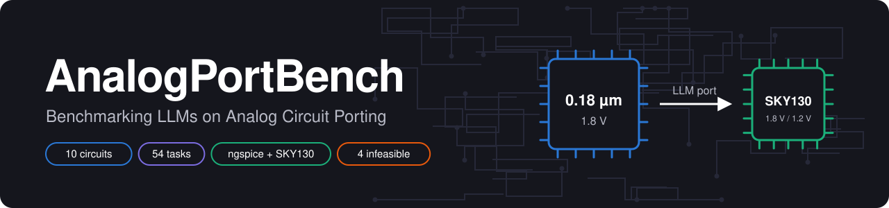
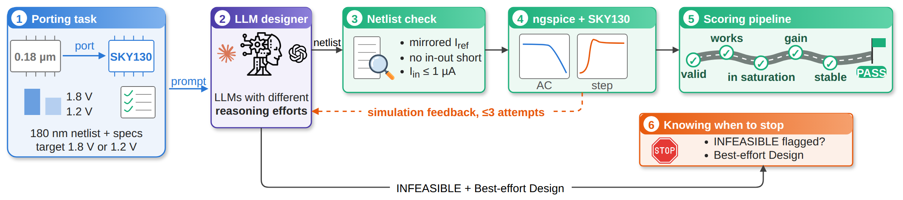
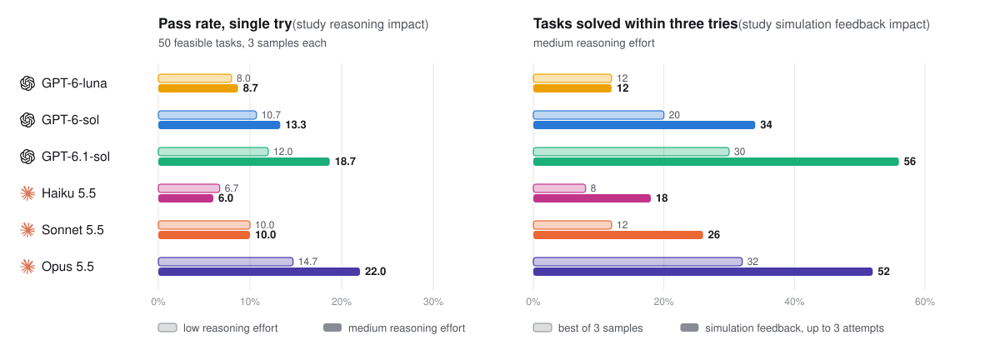
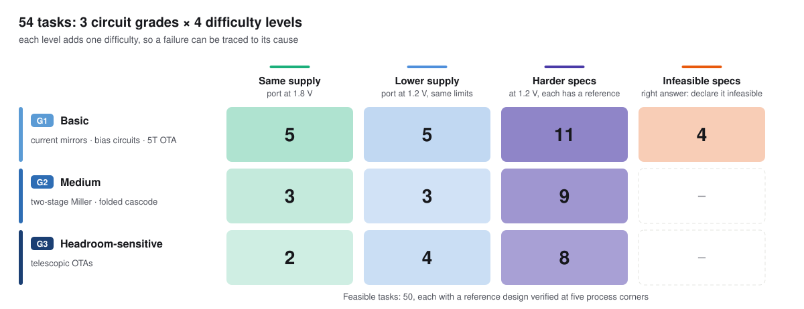

<p align="center">
  
</p>

[](https://arxiv.org/abs/2610.33088)


Welcome to the official repo of AnalogPortBench, a benchmark that tests whether LLMs can port analog circuits from one
process to another. An LLM receives a working analog design in a 0.18 µm process and a specification, and must return
a SKY130 netlist that meets it, often at a lower supply where the original topology no longer fits. Every answer is
scored by open-source simulation (ngspice + SKY130), and some tasks have deliberately infeasible porting
specifications: there, the right answer is to declare the task infeasible. This repository contains the tasks, the
evaluation flow and all model answers from the paper.

For further information, please refer to our [paper](https://arxiv.org/abs/2610.33088).

[[🌐 Webpage](https://saeidrajabii.github.io/AnalogPortBench/)] [[📑 Paper](https://arxiv.org/abs/2610.33088)] [[📊 Results](#results)] [[🧪 Evaluation](#evaluation)]

## 💥 News
* **[2026.10.21]** The [arXiv paper](https://arxiv.org/abs/2610.33088) is online.

## About AnalogPortBench

<p align="center"></p>

1. **Porting task.** The prompt gives the model the 0.18 µm netlist, the specification table and the target.
2. **LLM designer.** The model returns one SKY130 netlist. It may re-size, re-bias or change the topology.
3. **Netlist check.** The netlist must keep the required interface and pass three benchmark rules.
4. **Simulation.** ngspice with the SKY130 models runs the task's testbenches (DC, AC, step response, output swing) and
   the operating point of every transistor.
5. **Scoring.** The answer is scored as a checklist along the design flow: valid netlist, the circuit works, all
   transistors in saturation, gain or current error met, stable, and finally every specification met.
6. **Knowing when to stop.** On infeasible tasks, the right answer is to declare the task infeasible; declaring a
   feasible task infeasible counts as a false alarm.

In simulation-feedback mode, the measured results go back to the model for up to three attempts.

## Results

<p align="center"></p>

Left: share of answers that meet every specification on the 50 feasible tasks, with one try, at low and medium
reasoning effort. Right: share of the 50 feasible tasks solved within three tries at medium effort, by the best of
3 samples or with simulation feedback.

## The benchmark

<p align="center"></p>

Task names start with their level: **T1** same supply, **T2** lower supply, **T3** harder specs, **T4** infeasible
porting specifications (for example `T2__ota_tele__p0_as_source`).

## Installation

```bash
conda env create -f environment.yml && conda activate analog-port
bash scripts/setup_env.sh          # installs the SKY130 device models via ciel into $PDK_ROOT (default ~/.ciel)
```

## Evaluation

1. Send `prompts/system.txt` as the system prompt and `prompts/<task id>.txt` as the user message, with any client.
2. Save the reply and score it:

```bash
python benchmark/llm/score_answer.py T2__ota_tele__p0_as_source reply.txt
```

The scorer extracts the netlist, runs the netlist check and the benchmark rules, simulates it at TT and 27 °C, and
reports the outcome: **P** (every limit met), **F** (the circuit works but misses a limit), **D** (does not work: no
gain, or a current error above 50 %) or **I** (invalid: no netlist, a check or rule violation, or a simulation error),
together with the measured metrics, the failed limits and whether the reply declares `INFEASIBLE`.

**Simulation feedback mode.** In the paper, every possible task (T1–T3) whose first sample failed continued as a conversation of
at most three attempts. After each attempt the model received `benchmark/llm/feedback_template_v2.md`, filled in with
every metric, its limit, the measured value and whether it was met, and the operating point of each transistor.
The feedback actually sent is recorded in `results/feedback/<task>/<model>/turn<k>_feedback.txt`.

### Reference designs and baselines

```bash
python benchmark/evaluate.py ota_tele benchmark/golden/ota_tele_1v8.sp --vdd 1.8 \
       --spec benchmark/circuits/ota_tele/spec.yaml       # evaluate any netlist against any specification
python benchmark/golden/audit_golden.py                   # five-corner audit of all reference designs
python benchmark/baseline_v2.py                           # naive device-swap and reference baselines on all tasks
```

## Repository layout

```
prompts/                     the exact prompt of every task (54 files, named by task id) and the system prompt
benchmark/
  circuits/<circuit>/        source_180n.sp (0.18 µm design), spec.yaml (T1), spec_1v2.yaml (T2 where the scaled
                             limits differ), profiles/hard_*.yaml (T3), profiles/infeasible_*.yaml (T4, with the
                             derivation of the physical bound); ota_tele uses profiles/p0-p2 for T2
  testbenches/               ngspice testbench templates (DC, loop gain, open-loop AC, step, swing); not shown to models
  golden/                    reference SKY130 designs (*.sp) and audit_golden.py (five-corner audit)
  llm/                       score_answer.py (score one answer), check_netlist.py (netlist check and benchmark
                             rules), tasks_v2.py (task list), feedback and invalid-answer templates, frozen/ (prompt
                             template and hashes)
  results/                   all_answers.csv (every scored answer), zero_shot/ and feedback/ (extracted netlists and
                             scoring logs), golden_audit.md, corner_eval.md, v2_baselines.json
  evaluate.py                simulate one netlist against one specification
  measure.py, sim.py, netlist.py, techs.py, config.py, circuits.py    measurement, ngspice runner, parsing, settings
  naive_port.py, baseline_v2.py                                       device-swap baseline and reference baseline
  make_specs.py, make_scaled_specs.py                                 how the T1 and T2 limits were derived
scripts/setup_env.sh         conda environment and pinned SKY130 PDK
environment.yml
```

## Citation
If you find AnalogPortBench useful in your work, please cite our paper.

```bibtex
@misc{rajabi2026analogportbench,
  title         = {AnalogPortBench: Benchmarking {LLMs} on Analog Circuit Porting},
  author        = {Rajabi, Saeid and Moussa, Aly and Saxena, Vishal and Yang, Chengmo and Patnaik, Satwik},
  year          = {2026},
  eprint        = {2610.33088},
  archivePrefix = {arXiv},
  primaryClass  = {cs.AR},
  url           = {https://arxiv.org/abs/2610.33088}
}
```

## License

MIT License. See [LICENSE](LICENSE).
